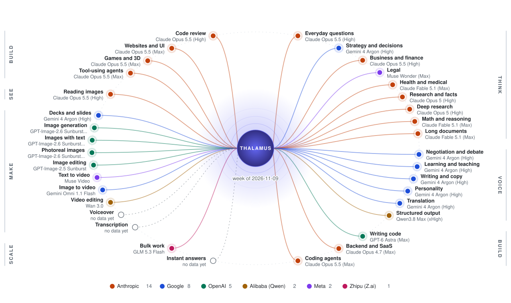
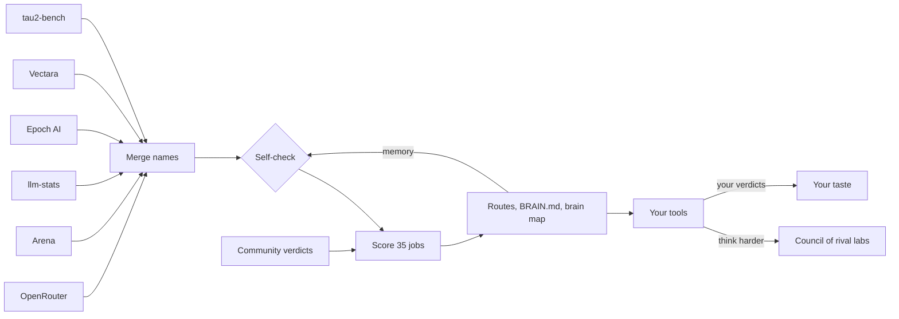

<p align="center">
  <picture>
    <source media="(prefers-color-scheme: dark)" srcset="assets/hero-dark.svg">
    
  </picture>
</p>

<h3 align="center">The right AI model for every job, re-ranked every Monday.</h3>

<p align="center">
Thalamus reads open AI leaderboards each week, ranks every model from every lab for 35 jobs, and tells Claude Code, Codex, Cursor and your other tools which one to use. It checks its own data, remembers past weeks and learns from your verdicts.
</p>

<p align="center">
  <a href="#this-weeks-picks">Picks</a> &nbsp;·&nbsp;
  <a href="#every-lab">Every lab</a> &nbsp;·&nbsp;
  <a href="#quick-start">Install</a> &nbsp;·&nbsp;
  <a href="#the-brain">The brain</a> &nbsp;·&nbsp;
  <a href="#the-council">Council</a> &nbsp;·&nbsp;
  <a href="ROUTES.md">All routes</a> &nbsp;·&nbsp;
  <a href="BRAIN.md">This week's self-check</a>
</p>

<p align="center">
  <a href="https://github.com/stephanochse/thalamus/actions/workflows/weekly-sync.yml"></a>
  <a href="https://github.com/stephanochse/thalamus/commits/main"></a>
  <a href="LICENSE"></a>
  
  
  
</p>

<!-- thalamus:example:start -->
```console
$ thalamus top general --labs
Everyday questions and chat (week of 2026-11-09)
Anthropic        Claude Opus 5.5 (High)       #1    100% of the top
Google           Gemini 4 Argon (High)        #3     99% of the top
Meta             Muse Wonder (Max)            #5     95% of the top
OpenAI           GPT-6 Astra (Max)            #9     92% of the top
Moonshot AI      Kimi K3 (Max)                #17    88% of the top
Zhipu (Z.ai)     GLM 5.3 (Max)                #29    87% of the top
Alibaba (Qwen)   Qwen3.8 Max (0902)           #30    87% of the top
DeepSeek         DeepSeek V4.1 Flash (Max)    #41    84% of the top
Xiaomi           MiMo-V2.6-Pro                #45    83% of the top
xAI              Grok 4.5                     #56    82% of the top
```
<!-- thalamus:example:end -->

## Why

No model is best at everything. This week's leader in coding isn't the leader in legal work, vision or video, and a model that's 90% as good often costs a tenth as much. The rankings move every week, and nobody has time to read six leaderboards on Monday and rewire their tools by hand.

Most routers stop at the top three names. Thalamus ranks every model it can find evidence for, from every lab: Anthropic, OpenAI, Google, xAI, Meta, DeepSeek, Moonshot, Qwen, Z.ai, Xiaomi, MiniMax, Mistral and more. Each job shows where every lab's best model stands, so a second opinion from a different lab is one lookup away.

In your brain, the thalamus sits in the middle and relays almost every signal to the region built for it: sight to the visual cortex, sound to the auditory cortex. This project does the same for models. Labs train on different data, in different countries, with different priorities, so each model is strong in different places and misses different mistakes. Thalamus sends each job to the model built for it, and when the stakes are high, it gets several of them to check the work.

## This week's picks

<!-- thalamus:headline:start -->
| Job | Best | Value | Other lab |
|---|---|---|---|
| Everyday questions and chat | Claude Opus 5.5 (High) | Gemini 4 Argon (High) | Gemini 4 Argon (High) |
| Strategy, plans and decisions | Gemini 4 Argon (High) | Gemini 4 Argon (High) | Claude Opus 5.5 (High) |
| Writing, copy and voice | Gemini 4 Argon (High) | Gemini 3.7 Flash (High) | Claude Opus 5.5 (High) |
| Writing code | GPT-6 Astra (Max) | Claude Sonnet 5.5 (xHigh) | Claude Sonnet 5.5 (xHigh) |
| Autonomous coding agents | Claude Opus 5.5 (Max) | Claude Sonnet 5.5 (Max) | GPT-6 Astra (Max) |
| Research and facts | Claude Opus 5 (High) | Qwen3.8 Max (0902) | Qwen3.8 Max (0902) |
| Reading images, screenshots and documents | Claude Opus 5.5 (High) | Gemini 3.8 Flash (High) | Gemini 3.8 Flash (High) |
| Image generation | GPT-Image-2.6 Sunburst (Medium) | - | - |
<!-- thalamus:headline:end -->

<details>
<summary><b>All 35 jobs</b>: best, value, budget, other lab, and what a mixed plan saves</summary>

**Value** is the cheapest model within 90% of the top quality, **budget** the cheapest within 75%. **Other lab** is the best model from a different lab than the best pick. **Mix saves** compares a plan that sends 10% of tokens to the best model, 30% to the value pick and 60% to the budget pick with sending everything to the best model.

<!-- thalamus:picks:start -->
| Job | Best | Value | Budget | Other lab | Mix saves |
|---|---|---|---|---|---|
| Everyday questions and chat | Claude Opus 5.5 (High) | Gemini 4 Argon (High) | GLM 5.3 Flash | Gemini 4 Argon (High) | 75% |
| Strategy, plans and decisions | Gemini 4 Argon (High) | Gemini 4 Argon (High) | GLM 5.3 Flash | Claude Opus 5.5 (High) | 59% |
| Business, finance and analysis | Claude Opus 5.5 (High) | Muse Spark 1.2 (xHigh) | GLM 5.3 Flash | GPT-6.1 Sol (Max) | 82% |
| Legal and compliance | Muse Wonder (Max) | Muse Spark 1.2 (xHigh) | GLM 5.3 Flash | Qwen3.7 Max | 82% |
| Health and medical | Claude Fable 5.1 (Max) | Gemini 3.7 Flash (High) | GLM 5.3 Flash | Muse Spark 1.2 (xHigh) | 88% |
| Research and facts | Claude Opus 5 (High) | Qwen3.8 Max (0902) | DeepSeek V4.1 Flash (Max) | Qwen3.8 Max (0902) | 80% |
| Deep research and investigations | Claude Opus 5 (High) | Qwen3.8 Max (0902) | Qwen3.8 Max (0902) | Qwen3.8 Max (0902) | 63% |
| Math and hard reasoning | Claude Fable 5.1 (Max) | Gemini 3.7 Flash (High) | GLM 5.3 Flash | Gemini 4 Argon (High) | 88% |
| Long documents and big codebases | Claude Fable 5.1 (Max) | Claude Opus 5 (High) | Gemini 3.7 Flash (High) |  | 70% |
| Negotiation, debate and persuasion | Gemini 4 Argon (High) | Gemini 4 Argon (High) | GLM 5.3 Flash | Claude Fable 5 (High) | 59% |
| Learning a skill and being taught | Gemini 4 Argon (High) | Gemini 4 Argon (High) | GLM 5.3 Flash | Claude Opus 5.5 (High) | 59% |
| Writing, copy and voice | Gemini 4 Argon (High) | Gemini 3.7 Flash (High) | GLM 5.3 Flash | Claude Opus 5.5 (High) | 78% |
| Personality and conversation | Gemini 4 Argon (High) | Gemini 3.8 Flash (High) | GLM 5.3 Flash | Muse Wonder (Max) | 77% |
| Translation and other languages | Gemini 4 Argon (High) | Gemini 3.7 Flash (High) | GLM 5.3 Flash | Muse Wonder (Max) | 78% |
| Following instructions and structured output | Qwen3.8 Max (xHigh) | Gemini 3.7 Flash (High) | GLM 5.3 Flash | GLM 5.3 Flash |  |
| Writing code | GPT-6 Astra (Max) | Claude Sonnet 5.5 (xHigh) | GLM 5.3 Flash | Claude Sonnet 5.5 (xHigh) | 84% |
| Backends, SaaS and system design | Claude Opus 4.7 (Max) | Muse Spark 1.2 (xHigh) | GLM 5.3 Flash | Gemini 4 Argon (High) | 84% |
| Autonomous coding agents | Claude Opus 5.5 (Max) | Claude Sonnet 5.5 (Max) | GPT-6.1 Terra (Max) | GPT-6 Astra (Max) | 60% |
| Code review and debugging | Claude Opus 5.5 (High) | Gemini 4 Argon (High) | GLM 5.3 Flash | Gemini 4 Argon (High) | 75% |
| Websites, UI and screenshot-to-code | Claude Opus 5.5 (Max) | Claude Sonnet 5.5 (xHigh) | Claude Sonnet 5.5 (xHigh) | GPT-6 Astra (Max) | 45% |
| Games, 3D and interactive scenes | Claude Opus 5.5 (Max) | Claude Sonnet 5.5 (xHigh) | DeepSeek V4.1 Flash (Max) | GPT-6 Astra (Max) | 74% |
| Tool use and multi-step agents | Claude Opus 5.5 (Max) | Claude Sonnet 5.5 (Max) | GPT-6.1 Terra (Max) | GPT-6 Astra (Max) | 60% |
| Reading images, screenshots and documents | Claude Opus 5.5 (High) | Gemini 3.8 Flash (High) | GLM 5.3 Flash | Gemini 3.8 Flash (High) | 83% |
| Decks, slides and one-pagers | Gemini 4 Argon (High) | Gemini 4 Argon (High) | GLM 5.3 Flash | Claude Opus 5.5 (High) | 59% |
| Image generation | GPT-Image-2.6 Sunburst (Medium) |  |  |  |  |
| Ads, posters and images with text | GPT-Image-2.6 Sunburst (Medium) |  |  |  |  |
| Photoreal images and product shots | GPT-Image-2.6 Sunburst (Medium) |  |  |  |  |
| Image editing | GPT-Image-2.5 Sunburst |  |  | MAI-Image-2.7-Preview |  |
| Video from text | Muse Video |  |  | Sora 2 Pro |  |
| Animate an image into video | Gemini Omni 1.1 Flash |  |  | SkyReels V4 |  |
| Video editing | Wan 3.0 |  |  | Dreamina Seedance 2.5 |  |
| Bulk work at the lowest price | GLM 5.3 Flash | GPT-6.1 Terra | GLM 5.3 Flash | DeepSeek V4.1 Flash (Max) |  |

_Updated 2026-11-09 by the weekly sync. Full tables: [ROUTES.md](ROUTES.md)._
<!-- thalamus:picks:end -->

</details>

<p align="center">
  <picture>
    <source media="(prefers-color-scheme: dark)" srcset="assets/brain-map-dark.svg">
    
  </picture>
</p>

<p align="center"><sub>Redrawn by the weekly sync. Each line runs from the thalamus to a job, coloured by the lab whose model won it.</sub></p>

## Every lab

How each lab did across all 35 jobs this week. "Strongest at" is the job where its best model gets closest to the top score. [ROUTES.md](ROUTES.md) lists every lab's best model for every job, with its rank.

<!-- thalamus:labs:start -->
| Lab | Jobs won | In the top 3 for | Strongest at |
|---|---|---|---|
| Anthropic | 14 | 22 | Everyday questions and chat (Claude Opus 5.5 (High)), 100% of the top |
| Google | 8 | 13 | Negotiation, debate and persuasion (Gemini 4 Argon (High)), 100% of the top |
| OpenAI | 5 | 10 | Writing code (GPT-6 Astra (Max)), 100% of the top |
| Meta | 2 | 6 | Legal and compliance (Muse Wonder (Max)), 100% of the top |
| Alibaba (Qwen) | 2 | 6 | Following instructions and structured output (Qwen3.8 Max (xHigh)), 100% of the top |
| Zhipu (Z.ai) | 1 | 1 | Bulk work at the lowest price (GLM 5.3 Flash), 100% of the top |
| ByteDance | 0 | 1 | Video editing (Dreamina Seedance 2.5), 97% of the top |
| skyreel | 0 | 1 | Animate an image into video (SkyReels V4), 97% of the top |
| DeepSeek | 0 | 1 | Business, finance and analysis (DeepSeek V4.1 Flash (Max)), 92% of the top |
| hidream | 0 | 1 | Animate an image into video (HiDream-O1-Video-1.0), 90% of the top |
| Microsoft | 0 | 1 | Image editing (MAI-Image-2.7-Preview), 86% of the top |
| Moonshot AI | 0 | 0 | Business, finance and analysis (Kimi K3 (Max)), 95% of the top |
| Xiaomi | 0 | 0 | Backends, SaaS and system design (MiMo-V2.6-Pro), 93% of the top |
| xAI | 0 | 0 | Animate an image into video (Grok Imagine Video 1.5), 90% of the top |
<!-- thalamus:labs:end -->

## Quick start

```bash
git clone https://github.com/stephanochse/thalamus && cd thalamus
python -m thalamus install                          # tools and rules into every AI app it finds
python -m thalamus route "fix the flaky checkout test"
```

Python 3.10, nothing else to install. The weekly data ships in the repo, so routing works offline, and `git pull` fetches next week's.

`install` registers the tools in Claude Code, Claude Desktop, Codex, Cursor, VS Code, Cline, Grok Build and Antigravity, and writes the routing rules into the ones that read a rules file. Then work as usual. Your agent calls `route` to pick a model for a subtask, `council` when you say "think harder", and `feedback` when you accept or reject its work.

> [!TIP]
> No API key is needed. The public data needs none, and the council runs on the model subscriptions you already have.

## How it works



| Step | What happens |
|---|---|
| Read | A GitHub Action pulls open data every Monday at 05:23 UTC. It runs in the cloud, so your laptop can be off. |
| Merge | The same model goes by five names across five sites ("DeepSeek V4 Pro Max", "deepseek-v4-pro (max)"). Thalamus merges them into one entry per model and effort level. |
| Check | Before it trusts the data, the brain compares it with last week and across sources. See [the brain](#the-brain). |
| Score | Each job is a weighted list of signals in [`thalamus/jobs.json`](thalamus/jobs.json). Every job gets best, value, budget, fast, open-weights and other-lab picks where the data supports them. |
| Publish | The Action commits `data/routes.json`, [ROUTES.md](ROUTES.md), [BRAIN.md](BRAIN.md), the brain map and the tables in this README. |

## The brain

Thalamus checks its own inputs every week, keeps a memory of past weeks, and writes down what it learned in [BRAIN.md](BRAIN.md).

| Check | What it does |
|---|---|
| Quarantine | A metric whose rankings reshuffle overnight, or that loses most of its rows, sits out the week. A broken feed can't crown a new number one. |
| Trust | Each source's rankings are compared with every other source's, job by job. A source whose agreement suddenly drops below its usual level, the way a broken feed would, loses weight until it recovers. |
| Steady picks | A challenger has to beat last week's best pick by more than a point. Noise doesn't flip your routing back and forth. |
| Memory | The top 15 for every job, for 26 weeks. Each week's tables show who is rising. |
| Blind spots | It lists strong new models it can't judge yet, because most boards haven't tested them, and suggests trying them on low-stakes work. |
| Many brains | Anyone with a GitHub account older than six months can file a [model verdict](https://github.com/stephanochse/thalamus/issues/new?template=verdict.yml). Once five different people have voted on a model, its score moves by up to 10%. Votes shift the rankings, value and budget picks, never the best pick. |
| Your taste | Your own verdicts bend your routing after three or more, and stay on your machine. |

## The council

The agent writes its own answer first and makes the final call. The council advises and never takes over.

| You say | What happens | Outside calls |
|---|---|---|
| anything else, including "be careful" | the agent checks its own work harder | 0 |
| "think harder", "second opinion" | one model from another lab reviews the answer | 1 |
| "go deep", "think much harder" | three other labs answer blind | 3 |
| "ultrathink", "all hands", "convene the council" | every lab at top effort, anonymized cross-critique, then a red-team pass | 7+ |

Seats come from different labs and countries on purpose: models raised on different data catch different mistakes. Before anything leaves your machine, keys, tokens, emails, phone numbers and your own private terms are removed.

## Use what you already pay for

The council and the router call models through the plans you have: Claude Code (Claude plan), Codex (ChatGPT plan), Grok Build (Grok plan) and Antigravity (Google plan). Those calls count against your plan limits and add no per-token bill, and Thalamus starts each tool with API keys removed so it can't fall back to an API account. Everything else goes through [OpenRouter](https://openrouter.ai) with your key, or a local model through Ollama. `python -m thalamus doctor --live` checks every login.

Tell Thalamus what you have and what you like in `~/.thalamus/config.json`:

```json
{
  "access": ["claude-cli", "codex", "grok", "openrouter"],
  "served": {"claude-cli": "^anthropic/claude-(opus|sonnet|haiku)", "codex": "^openai/gpt-6", "grok": "^x-ai/grok-4"},
  "favourites": ["x-ai/grok", "moonshotai/kimi", "deepseek/", "xiaomi/mimo", "qwen/", "z-ai/glm"],
  "prefer_subscriptions": true
}
```

`served` says which models each plan includes, so `route` offers a subscription pick only when a model matches. `favourites` makes every `route` answer show where the model families you like stand for that task, wherever they rank.

`route` matches the task to a job by keywords. A phrase counts double, a keyword several jobs share counts less, and one stray word can't decide a long brief: every answer carries a `confidence` and lists the other jobs the task touches under `also`. Add `"classifier": true` to the config (or pass `--classify`) and a weak match goes to a decision model on OpenRouter instead, with your key, at about $0.00002 a call. It's off by default, and the task text is scrubbed before it leaves your machine. When a job has no public scores this week, `route` says so and lists free local tools that do the job, such as faster-whisper for transcription.

## It learns your taste

```bash
python -m thalamus feedback writing x-ai/grok-4.7 good --note "kept my voice"
python -m thalamus feedback code-build some/model --beats other/model
python -m thalamus feedback legal moonshotai/kimi-k3 good --share   # also add it to the public rankings
python -m thalamus learn             # what your verdicts taught it
python -m thalamus scout writing     # an untried strong model to test next
python -m thalamus top legal --labs  # every lab's best model for one job
python -m thalamus brain             # what this week's self-check found
```

One bad day can't rewrite routing. A model needs three verdicts before your taste overrides the public pick.

## Where the data comes from

Thalamus reads only what publishers allow: official APIs and open datasets. It never scrapes a site whose terms forbid it.

| Source | Adds | Terms |
|---|---|---|
| [OpenRouter](https://openrouter.ai) API | models, prices, context windows | public API |
| [Arena](https://arena.ai) open dataset | human preference across text, coding, vision, documents, search, agents, image and video | CC BY 4.0 |
| [llm-stats](https://llm-stats.com) API | category indexes, plus 20 benchmarks as the labs report them | reuse with attribution |
| [Epoch AI](https://epoch.ai) | Capabilities Index, SWE-bench runs | CC BY 4.0 |
| [Vectara](https://github.com/vectara/hallucination-leaderboard) | how often a model invents facts when it summarises | Apache-2.0 |
| [tau2-bench](https://github.com/sierra-research/tau2-bench) | agents using tools under a written policy | MIT |

Benchmarks that labs report about their own models count as "claims": small weights that can lift a model's score but never count against one that lacks them. Artificial Analysis and a few other sources feed a personal build on your own machine and never appear in the public rankings. Details and reasons in [docs/SOURCES.md](docs/SOURCES.md), weights and maths in [docs/METHOD.md](docs/METHOD.md).

## For creators

Image, video and voice models sit inside platforms more often than behind APIs. `python -m thalamus media --platform higgsfield` lists what your platform offers on your login and shows this week's best image, edit, video and voice models you can use there. Any other platform works with a plain list of model names.

## FAQ

<details>
<summary>Do I need API keys?</summary>

No. The weekly rankings ship with the repo, and the council uses your existing plan logins. A key helps only for models you reach through OpenRouter.
</details>

<details>
<summary>My favourite model isn't in the picks. Is it bad?</summary>

Probably not. Picks show three models per job, and the gap between first and tenth is often a few points. Every job in [ROUTES.md](ROUTES.md) lists the best model from each lab with its rank and its share of the top score, and `favourites` in your config puts the families you like in every `route` answer. If it does well for you, record a verdict: three of yours move your own routing.
</details>

<details>
<summary>Why not use the top model for everything?</summary>

You can. It costs more and it's rarely the best at every job. The mixed-plan figure in each table shows what a split saves.
</details>

<details>
<summary>Who sees my verdicts and prompts?</summary>

Your verdicts stay in `~/.thalamus` unless you share one with `--share`, which opens a public GitHub issue you can read before you submit. Council prompts go to the model vendors you chose, after private terms, keys and contact details are removed.
</details>

<details>
<summary>Why are some jobs marked "not enough data"?</summary>

Instant answers, voiceover and transcription need measured speed or audio data that no open source publishes yet. They fill in on a personal build with Artificial Analysis.
</details>

<details>
<summary>Does an AI model write BRAIN.md?</summary>

No. Every check is plain arithmetic in [`thalamus/brain.py`](thalamus/brain.py), so the same data always gives the same page and anyone can audit it.
</details>

## Jobs

| Group | Jobs |
|---|---|
| Think | everyday questions, strategy and decisions, business and finance, legal, health and medical, research and facts, math, long documents |
| Voice | writing and copy, personality and conversation, translation, structured output |
| Build | writing code, autonomous coding agents, code review, websites and screenshot-to-code, tool-using agents |
| See | images, screenshots and documents |
| Make | image generation, ads and images with text, photoreal and product shots, image editing, video, image-to-video, video editing, voiceover, transcription |
| Scale | bulk work at the lowest price, instant answers |

Change a weight in [`thalamus/jobs.json`](thalamus/jobs.json) and the next run follows.

## Run your own copy

Fork it, then open **Actions** in your fork and enable workflows. The weekly sync runs every Monday and commits the new routes to your fork. A source that fails keeps last week's data and says so; a week with too few fresh sources is refused rather than committed.

With a free [Artificial Analysis](https://artificialanalysis.ai) API key you can add their data on your own machine:

```bash
export ARTIFICIAL_ANALYSIS_API_KEY=...        # or put it in ~/.thalamus/env
python -m thalamus update --personal --with aa,epoch_external
```

That writes to `~/.thalamus/data`, never to the repo, and routing uses it while it's at least as fresh as the public data.

## Contributing and credits

Add a source by writing one module in `thalamus/sources/`; the steps are in [docs/SOURCES.md](docs/SOURCES.md). Issues, verdicts and pull requests are welcome.

The rankings are built on the work of [OpenRouter](https://openrouter.ai), [Arena](https://arena.ai), [llm-stats](https://llm-stats.com), [Epoch AI](https://epoch.ai), [Vectara](https://github.com/vectara/hallucination-leaderboard) and [Sierra](https://github.com/sierra-research/tau2-bench). Go read them.

Ideas borrowed with thanks: anonymized peer review from [karpathy/llm-council](https://github.com/karpathy/llm-council); "commit your own answer before the panel speaks" from [antonbabenko/deliberation](https://github.com/antonbabenko/deliberation); adversarial review stances from [openai/codex-plugin-cc](https://github.com/openai/codex-plugin-cc) and [BeehiveInnovations/pal-mcp-server](https://github.com/BeehiveInnovations/pal-mcp-server); one rules source written into many tools from [dyoshikawa/rulesync](https://github.com/dyoshikawa/rulesync) and [intellectronica/ruler](https://github.com/intellectronica/ruler); validate-before-adopting from [microsoft/SkillOpt](https://github.com/microsoft/SkillOpt); seats from a vendor other than the host from [Lykhoyda/ask-llm](https://github.com/Lykhoyda/ask-llm); independent-first answers from [zhjai/agent-arena](https://github.com/zhjai/agent-arena).

MIT licensed. Data stays under each source's own terms.
