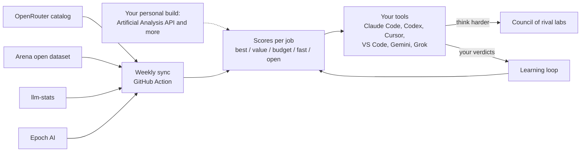

<h1 align="center">Thalamus</h1>

<p align="center"><b>Every AI model on Earth, each doing the job it was built for.</b></p>

<p align="center">
One brain for Claude Code, Codex, Cursor, VS Code, Gemini and Grok. Every week it re-reads the public AI leaderboards, scores every model for 29 kinds of work, and tells your AI tools which model fits each task: the expensive frontier model for the 10% that needs it, a model that's 90% as good at a tenth of the price for the rest. Say "think harder" and it convenes a council of models from rival labs and countries. Tell it what worked, and it learns your taste.
</p>

<p align="center">
<a href="../../actions/workflows/weekly-sync.yml"></a>


</p>

---

## Why

No single model is best at everything. This week's leader in coding isn't the leader in legal work, voiceover or video, and the cheapest model within 10% of the leader often costs a tenth as much. The rankings also move every week. Nobody has time to read six leaderboards every Monday and re-wire their tools by hand.

In your brain, the thalamus sits in the middle and relays almost every signal you take in to the region built to handle it: sight to the visual cortex, sound to the auditory cortex. Its loops with the cortex are part of what neuroscientists link to consciousness, many specialist regions working as one mind. Thalamus does that for AI models. Every lab trained its models on different data, with different priorities, in a different country, so each one is good at different things and catches different mistakes. Thalamus sends each job to the model built for it, and when it matters, it gets them talking.

## What it does



1. **Reads the leaderboards, every week.** A GitHub Action pulls open leaderboard data on Monday, fuses it into one catalog (the same model goes by five different names across five sites) and commits the new rankings. It runs in the cloud, so it happens whether your laptop is on or not. It only reads sources whose terms allow it: official APIs and open datasets, never scraped pages.
2. **Routes every job.** 29 jobs, from strategy, legal and long documents to screenshot-to-code, image editing and video. Each job gets up to five picks where the data supports them: **best**, **value** (cheapest model within 90% of the top quality), **budget** (cheapest within 75%), **fast** and **open weights**. Models with no public API show in the tables but are never picked.
3. **Convenes the council.** "Think harder" brings one model from another lab in to review. "Go deep" asks three labs blind. "Ultrathink" asks every lab, has them critique each other's anonymized answers, then red-teams the result. Seats come from different labs and countries on purpose: models raised on different data catch different mistakes.
4. **Learns your taste.** Tell it a model did well or badly, or which of two answers won. Your verdicts stay on your machine and bend the public rankings toward what works for you. A scout mode tests promising new releases on your low-stakes tasks, so it keeps learning as models change.
5. **Installs everywhere.** One command registers the tools in Claude Code, Claude Desktop, Codex, Cursor, VS Code, Cline, Grok Build and Antigravity, and writes the rules into the ones that read a rules file (all of them except Claude Desktop and Cursor).

## This week's picks

<!-- thalamus:picks:start -->
| Job | Best | Value | Budget | Mix saves |
|---|---|---|---|---|
| Everyday questions and chat | Claude Opus 5.5 (High) | Gemini 4 Argon (High) | GLM 5.3 Flash | 75% |
| Strategy, plans and decisions | Gemini 4 Argon (High) | Gemini 4 Argon (High) | GLM 5.3 Flash | 59% |
| Business, finance and analysis | Claude Opus 5.5 (High) | Muse Spark 1.2 (xHigh) | GLM 5.3 Flash | 82% |
| Legal and compliance | Muse Wonder (Max) | Muse Spark 1.2 (xHigh) | GLM 5.3 Flash | 82% |
| Health and medical | Gemini 4 Argon (High) | Gemini 4 Argon (High) | GLM 5.3 Flash | 59% |
| Research and facts | Claude Opus 5.5 (High) | Gemini 4 Argon (High) | MiMo-V2.6-Pro | 71% |
| Math and hard reasoning | Claude Fable 5.1 (Max) | Gemini 3.8 Flash (High) | GLM 5.3 Flash | 87% |
| Long documents and big codebases | Claude Opus 5 (High) | Claude Opus 5 (High) | GPT-5.6 Sol (xHigh) | 12% |
| Writing, copy and voice | Claude Opus 5.5 (High) | Gemini 3.7 Flash (High) | GLM 5.3 Flash | 84% |
| Personality and conversation | Gemini 4 Argon (High) | Gemini 3.8 Flash (High) | GLM 5.3 Flash | 77% |
| Translation and other languages | Gemini 4 Argon (High) | Gemini 3.7 Flash (High) | GLM 5.3 Flash | 78% |
| Following instructions and structured output | Qwen3.7 Plus | Gemini 4 Argon (High) | GLM 5.3 Flash |  |
| Writing code | GPT-6 Astra (Max) | Claude Sonnet 5.5 (xHigh) | GLM 5.3 Flash | 84% |
| Autonomous coding agents | Claude Opus 5.5 (Max) | Claude Opus 5.5 (Max) | Claude Sonnet 5.5 (Max) | 30% |
| Code review and debugging | Claude Opus 5.5 (High) | MiMo-V2.6-Pro | GLM 5.3 Flash | 88% |
| Websites, UI and screenshot-to-code | Claude Opus 5.5 (Max) | Claude Sonnet 5.5 (xHigh) | GPT-6.1 Terra (Max) | 60% |
| Tool use and multi-step agents | Claude Opus 5.5 (Max) | Claude Opus 5.5 (Max) | GPT-6.1 Terra (Max) | 45% |
| Reading images, screenshots and documents | Claude Fable 5 (High) | Gemini 3.8 Flash (High) | GLM 5.3 Flash | 87% |
| Image generation | GPT-Image-2 (Medium) |  |  |  |
| Ads, posters and images with text | GPT-Image-2 (Medium) |  |  |  |
| Photoreal images and product shots | GPT-Image-2 (Medium) |  |  |  |
| Image editing | GPT-Image-2.5 Sunburst |  |  |  |
| Video from text | grok-imagine-video-1.5-agent |  |  |  |
| Animate an image into video | gemini-omni-1.1-flash |  |  |  |
| Video editing | wan3.0 |  |  |  |
| Bulk work at the lowest price | GLM 5.3 Flash | GPT-6.1 Terra | GLM 5.3 Flash |  |

_Updated 2026-11-02 by the weekly sync. Full tables: [ROUTES.md](ROUTES.md)._
<!-- thalamus:picks:end -->

## Quick start

```bash
git clone https://github.com/stephanochse/thalamus && cd thalamus
python -m thalamus install          # rules + MCP tools into every AI app it finds
python -m thalamus route "turn this screenshot into a React landing page"
```

No dependencies beyond Python 3.10. The weekly data ships with the repo, so routing works offline. `git pull` gets next week's.

Then, inside any connected tool, just work. The agent calls `route` to pick models for subtasks, `council` when you say "think harder", and `feedback` when you accept or reject its work.

## Use what you already pay for

The council and the router call models through the subscriptions you already have, using each vendor's own command-line tool on your own login: Claude Code (Claude plan), Codex (ChatGPT plan), Grok Build (Grok plan) and Antigravity (Google plan). Those calls count against your plan's usage limits instead of a per-token bill, and Thalamus starts each CLI with API keys and backend switches removed so it can't fall back to billing an API account. Everything else goes through [OpenRouter](https://openrouter.ai) with your own key, or a local model through Ollama. `python -m thalamus doctor --live` checks every login.

Tell it which channels you have, and which models each subscription serves on your plan, in `~/.thalamus/config.json`. A lab's name alone doesn't say what your plan includes, so `route` only offers a subscription pick when a model matches your `served` pattern:

```json
{
  "access": ["claude-cli", "codex", "openrouter"],
  "served": {"claude-cli": "^anthropic/claude-(opus|sonnet|haiku)", "codex": "^openai/gpt-6"},
  "prefer_subscriptions": true,
  "private_contexts": ["private"]
}
```

The CLIs get a clean environment with every API key removed, so they run on your plan login rather than billing an API account.

## The effort ladder

| You say | What happens | Outside calls |
|---|---|---|
| anything else, including "be careful" | the agent checks its own work harder | 0 |
| "think harder", "second opinion" | one model from another lab reviews the answer | 1 |
| "go deep", "think much harder" | three other labs answer without seeing each other | 3 |
| "ultrathink", "all hands", "convene the council" | every lab at top effort, anonymized cross-critique, then a red-team pass on the final | 7+ |

The agent always writes its own answer first and makes the final call, so the council advises and never takes over. Before anything leaves your machine, keys, tokens, emails, phone numbers and your own private terms are removed.

## The money

Most work isn't uniformly hard. The plan, the final review and the decisions are the small share where a top model earns its price. Every job in [ROUTES.md](ROUTES.md) shows what a mixed plan costs (best model for 10% of tokens, value pick for 30%, budget pick for 60%) against sending everything to the top model.

## The learning loop

```bash
python -m thalamus feedback writing anthropic/claude-sonnet-5 good --note "kept my voice"
python -m thalamus feedback code-build some/model --beats other/model
python -m thalamus learn            # what your verdicts have taught it
python -m thalamus scout writing    # an untried strong model to test next
```

Each verdict updates a belief per job and model. One bad day can't rewrite routing: a model needs three or more verdicts before your taste can overturn the public pick. That gate is borrowed from the idea that a learned rule must beat the baseline before it replaces it.

## For creators

Image, video and voice models live inside aggregator platforms more often than behind APIs. `python -m thalamus media --platform higgsfield` lists what your platform offers on your own login and shows this week's best image, edit, video, image-to-video and voice models you can use there. Any other platform works with a plain list of model names.

## Jobs

| Group | Jobs |
|---|---|
| Think | everyday questions, strategy and decisions, business and finance, legal, health and medical, research and facts, math, long documents |
| Voice | writing and copy, personality and conversation, translation, structured output |
| Build | writing code, autonomous coding agents, code review, websites and screenshot-to-code, tool-using agents |
| See | images, screenshots and documents |
| Make | image generation, ads and images with text, photoreal and product shots, image editing, video, image-to-video, video editing, voiceover, transcription |
| Scale | bulk work at the lowest price, instant answers |

Voiceover, transcription and instant answers need speed and audio data that only the Artificial Analysis API publishes, so they're ranked in personal builds only (below).

Each job is a weighted list of public signals in [`thalamus/jobs.json`](thalamus/jobs.json). Change a weight and the next run follows. How scores are built: [docs/METHOD.md](docs/METHOD.md).

## Run your own copy

Fork it, then in your fork open **Actions** and enable workflows. The weekly sync runs every Monday and commits the new routes to your fork. A source that fails keeps last week's data and says so; a week with too few fresh sources is refused rather than committed.

### Personal build

Some of the best data can't be republished, but you can use it yourself. With a free [Artificial Analysis](https://artificialanalysis.ai) API key:

```bash
export ARTIFICIAL_ANALYSIS_API_KEY=...        # or put it in ~/.thalamus/env
python -m thalamus update --personal --with aa,epoch_external
```

That adds Artificial Analysis's capability indexes (strategy, legal, finance, healthcare, engineering), speed and voice boards, plus third-party benchmarks Epoch collects. It writes to `~/.thalamus/data`, never to the repo, and routing uses it automatically while it's at least as fresh as the public data. Details: [docs/SOURCES.md](docs/SOURCES.md).

## Privacy

- Your feedback, council runs and config live in `~/.thalamus/`, never in the repo.
- Contexts you mark private never reach metered third-party APIs.
- The scrubber is a safety net, not a guarantee. Keep briefs minimal.

## Sources and credits

The public rankings are built from data published by [OpenRouter](https://openrouter.ai), [Arena](https://arena.ai) (open dataset, CC BY 4.0), [llm-stats](https://llm-stats.com) and [Epoch AI](https://epoch.ai) (CC BY 4.0). Go read them, they do the hard work. Personal builds can add [Artificial Analysis](https://artificialanalysis.ai), [BenchLM](https://benchlm.ai) and [EQ-Bench](https://eqbench.com). Each week's exact sources and status are in [ROUTES.md](ROUTES.md); why each source is in or out is in [docs/SOURCES.md](docs/SOURCES.md).

Ideas borrowed with thanks: anonymized peer review from [karpathy/llm-council](https://github.com/karpathy/llm-council); "commit your own answer before the panel speaks" from [antonbabenko/deliberation](https://github.com/antonbabenko/deliberation); adversarial review stances from [openai/codex-plugin-cc](https://github.com/openai/codex-plugin-cc) and [BeehiveInnovations/pal-mcp-server](https://github.com/BeehiveInnovations/pal-mcp-server); one rules source written into many tools from [dyoshikawa/rulesync](https://github.com/dyoshikawa/rulesync) and [intellectronica/ruler](https://github.com/intellectronica/ruler); validate-before-adopting from [microsoft/SkillOpt](https://github.com/microsoft/SkillOpt); seats from a vendor other than the host from [Lykhoyda/ask-llm](https://github.com/Lykhoyda/ask-llm); independent-first answers from [zhjai/agent-arena](https://github.com/zhjai/agent-arena).

## License

MIT
